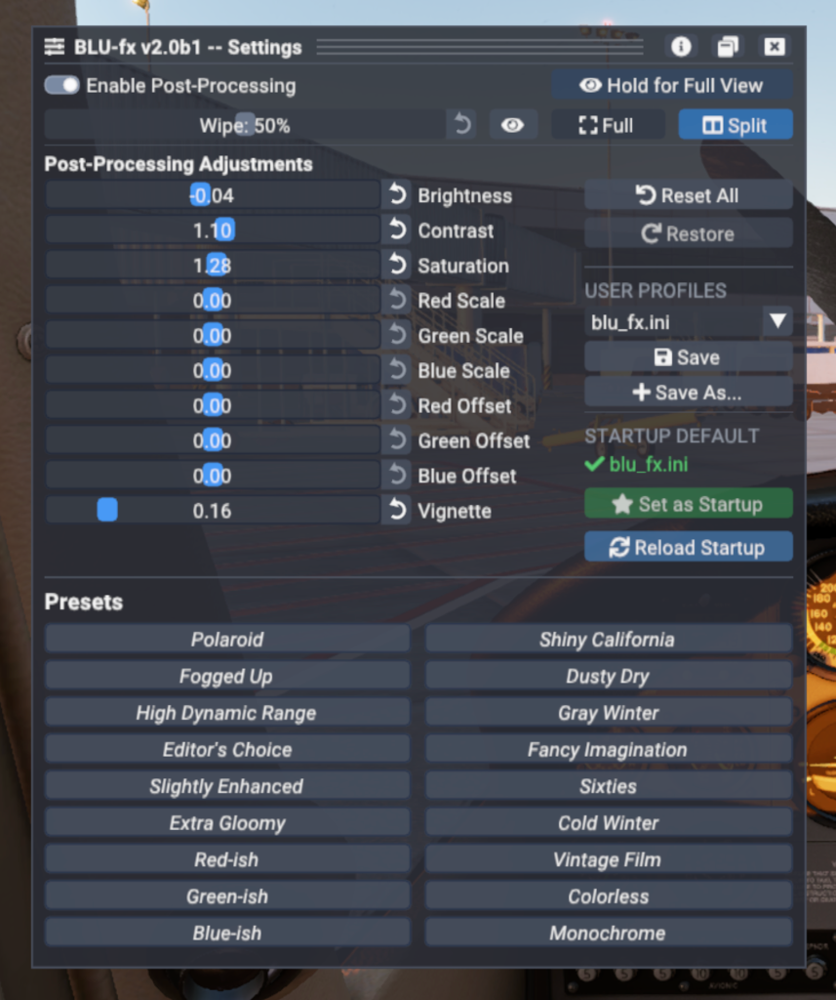

# BLU-fx User Guide

**BLU-fx** is a lightweight, real-time post-processing color grading plugin for X-Plane 12 and X-Plane 11 across macOS, Windows, and Linux. It allows you to customize scene brightness, contrast, color temperature, and atmospheric styling with zero noticeable impact on flight simulator framerates.

_Yes, it works on <u>all</u> X-Plane configurations from X-Plane 11 through the latest X-Plane 12.4.4 and beyond -- whether using OpenGL or Vulkan/Metal!_

---

## 1. Quick Start

Getting started with BLU-fx takes less than a minute:

1. Open the simulator menu and select `Plugins > BLU-fx > Settings window` (or press the configured keyboard shortcut, if you have defined one).
2. If it's off, be sure to flip the **Enable Post-Processing** toggle at the top left to turn filters ON.
3. In the **Presets** section at the bottom, click any preset (such as **Shiny California**, **High Dynamic Range**, or **Cold Winter**) to immediately transform your simulator scenery.
4. By default, BLU-fx opens in **Split** preview mode, showing your raw X-Plane scenery on the left half of the screen and the color grade on the right half. Drag the **Wipe** slider back and forth to compare before and after!

 

---

## 2. What's New & Upgrading from Previous Versions

Whether you are updating from the recent 64-bit release or rediscovering BLU-fx after flying X-Plane 9 or 10 years ago, this modernized release brings contemporary user interface design, enhanced multi-profile management, and full compatibility with the latest simulator technology:

- **Modern Dear ImGui & ImGee Interface:** A crisp, scalable, high-DPI interface with smooth mouse wheel stepping (0.01 increments), direct keyboard numeric typing, a one-click "Reset All" button, and an integrated User Guide viewer with live hot-reloading and direct PDF access.
- **Explicit Profile Management (No Blind Auto-Saving):** Legacy releases silently auto-saved whatever adjustments were active when X-Plane quit, easily clobbering your favorite looks by accident. Modern BLU-fx never overwrites your files without your permission. You can tweak sliders freely in flight and explicitly manage an entire library of named profiles inside the dedicated `profiles` folder.
- **Dedicated UI Preferences** (`Output/preferences/blu_fx.prf`): Color grading numbers stay in their respective profile `.ini` files, while your UI layout, split preview mode, curtain wipe percentage, hairline divider visibility, and window positions are remembered across sessions in a separate preferences file.
- **Flexible Live Split Preview:** Original versions offered a fixed 50/50 split with an invisible dividing seam. Modern BLU-fx adds a smooth curtain wipe slider (5% to 95%) and a toggleable hairline divider so you can compare before and after with pixel-level precision.
- **16 Curated Presets:** Instant visual styles with active status checkmarks (`✔`) and edit tracking indicators (`*`).
- **Universal Architecture:** Native Apple Silicon (M1/M2/M3/M4) and 64-bit Intel macOS support, alongside 64-bit Windows and Linux.

### Two Effortless Upgrade Paths

We know simmers have invested time dialing in their favorite color grading profiles over the years. Upgrading is designed to be completely seamless:

#### Path 1: Upgrading from the Previous 64-Bit Release
If you have been using the previous 64-bit release, your upgrade is 100% automatic -- you do not need to do anything! 

When modern BLU-fx launches, it automatically detects your existing `blu_fx.ini` file in the plugin root. It safely migrates the file into the new `profiles/` subdirectory (with collision-guard backups if needed), initializes your `Output/preferences/blu_fx.prf` preferences, and preserves your custom settings seamlessly.

#### Path 2: Returning from X-Plane 9, 10, or Early 11
If you are returning to BLU-fx after years away: welcome back! If you still have your vintage `blu_fx.ini` file from your older setup, you can bring it right along with you. 

Modern BLU-fx proudly maintains full backward compatibility with the original `.ini` file structure. Simply copy your old `blu_fx.ini` into the `Resources/plugins/blu_fx/` folder (or straight into `profiles/`). BLU-fx will detect, adopt, and migrate your classic settings automatically.

> [!TIP]
> **Flying Both X-Plane 11 and X-Plane 12?** Keep a separate copy of your favorite profile for each simulator. Because X-Plane 12 uses a completely redesigned photometric lighting engine, a profile that looks perfect in X-Plane 11 may benefit from slight brightness and contrast adjustments in X-Plane 12.

### Differences Between X-Plane 11 and X-Plane 12

When running BLU-fx under X-Plane 12, you will notice a few adjustments compared to X-Plane 11:

- **Raleigh Scale:** In X-Plane 11, BLU-fx included an atmospheric Rayleigh scattering slider (`sim/private/controls/atmo/atmo_scale_raleigh`). In X-Plane 12, Laminar Research replaced the old sky model with an entirely new physical photometric atmospheric engine, retiring the legacy Rayleigh dataref. BLU-fx automatically detects X-Plane 12 and cleanly hides the Raleigh slider, while keeping it active when running under X-Plane 11.
- **Cinema Verité & FPS Limiter:** Classic camera shaking overrides and the built-in frame limiter from legacy releases have been retired under X-Plane 12. Modern camera dynamics are best handled natively or via specialized camera tools (such as A-Better-Camera), and frame pacing is managed by modern GPU drivers and simulator display settings.

---

## 3. Live Preview Controls

When tuning visual styles, you want to see exactly how your adjustments affect terrain, clouds, and cockpit instruments without guessing. BLU-fx provides a non-destructive live preview system built directly into the settings header:

### Preview Modes: [ Full | Split ]
- **Split Mode:** Divides your simulator display into two halves. The left side displays your unmodified X-Plane rendering, while the right side applies your active color grading profile in real time.
- **Full Mode:** Applies your adjustments across 100% of your screen while the Settings window is open.

### The Curtain Wipe Slider
In Split mode, the **Wipe** slider lets you position the split boundary anywhere across your monitor from **5%** (almost full grade) to **95%** (almost full raw scenery). 
- Drag the slider thumb, or hover and spin your mouse wheel to slide the wipe boundary smoothly across your screen.
- Click the reset arrow next to the slider at any time to return the curtain to the default **50%** midpoint.

### Hairline Divider Toggle
Click the **eye icon** button beside the wipe slider to toggle the split boundary line on or off:
- **Divider ON:** Displays a subtle high-contrast hairline showing the exact boundary between raw scenery and post-processed grading.
- **Divider OFF:** Hides the line completely for seamless, pixel-to-pixel comparison without visual obstruction.

### Momentary Full View
In Split mode, you can click and hold the **Hold for Full View** button in the upper right. While held down, your full screen displays the active color grade; releasing the mouse immediately snaps back to your split-screen view.

 

> [!TIP]
> **Pilot ProTip:** You can assign this same momentary check to a physical joystick paddle or keyboard shortcut using the command `blu_fx/post_processing/momentary`.

---

## 4. Color Grading Adjustments

BLU-fx provides fine-grained controls for dialing in atmospheric tone and contrast:

### Global Tone Controls
- **Brightness:** Adjusts overall scene exposure. Increasing brightness lifts shadowy terrain and clouds, while decreasing brightness helps with intense direct sunlight.
- **Contrast:** Adjusts the tonal curve between dark and light regions. Higher contrast deepens dark valleys and pops highlights; lower contrast creates a soft, misty atmospheric look.
- **Saturation:** Controls overall color intensity. Dial it up for rich, vibrant summer flying, or pull it down toward zero for a moody, overcast atmosphere or black-and-white training look.

### Color Balance (RGB Scales / Gains)
- **Red Scale, Green Scale, Blue Scale:** Multiplies color intensity in highlights and midtones. 
  - To simulate a warm sunset or golden hour, boost **Red Scale** slightly and pull **Blue Scale** down.
  - For high-altitude cruising or cold arctic skies, increase **Blue Scale**.

### Black Levels & Shadow Tint (RGB Offsets / Lift)
- **Red Offset, Green Offset, Blue Offset:** Adds or subtracts color directly in shadows and darker pixels. 
  - Boosting offsets gives shadows a stylized matte or cinematic film tint without washing out the bright sky.

### Vignette
- **Vignette Slider:** Adds a subtle peripheral lens darkening around the edges of your display, drawing focus toward the center of your windshield and cockpit instruments.

### Precision Adjustment & Reset Buttons
- **Stepping:** Click the numeric values to type an exact number, or hover and roll your mouse wheel for fine 0.01 stepping.
- **Reset Buttons (↺):** Every slider features an individual reset button directly beside its label. Clicking it restores that specific parameter to its default baseline value.
- **Reset All:** Resets all ten sliders back to neutral factory settings in a single click.
- **Restore:** Reverts all sliders back to the values you had when you first opened the profile.

---

## 5. Presets, Profiles, and Startup Defaults

BLU-fx makes it easy to switch visual themes on the fly, save custom looks for specific regions or seasons, and configure which look loads automatically whenever you start X-Plane.

### Curated Factory Presets
At the bottom of the Settings window, a grid of 16 built-in presets offers quick visual styles:
- *Shiny California* -- punchy, warm, high-contrast summer lighting.
- *High Dynamic Range* -- deep shadow detail and vivid sky tones.
- *Cold Winter* -- crisp, desaturated cool tones perfect for snow scenery.
- *Fogged Up* & *Extra Gloomy* -- atmospheric, low-contrast overcast settings.
- *Vintage Film* & *Monochrome* -- stylized historic and black-and-white looks.

When a preset is active, its button displays a green checkmark (`✔`). If you adjust any slider, the checkmark turns into an edit indicator (`*`), reminding you that your current settings differ from the saved preset.

### Saving Custom User Profiles
You can save any combination of slider adjustments to a reusable profile:
- **Save:** Overwrites the currently selected user profile `.ini` file in your `profiles/` directory.
- **Save As...:** Opens a clean dialog letting you enter a new name (e.g. `My_Alpine_Dusk.ini`).

### Setting the Sim Startup Default
BLU-fx distinguishes between *saving a file* and *choosing what loads on sim boot*:
- To make your current look load automatically every time you launch X-Plane, click **Set as Startup**.
- The green **Startup Default** status badge will update immediately, confirming your chosen profile or preset will be applied on every future flight.
- If you ever want to discard active tweaks and return to your boot default during flight, click **Reload Startup**.

### Downgrade Safety & Legacy Mirroring
BLU-fx v2.0 introduces multi-profile support and stores user profiles in `Resources/plugins/blu_fx/profiles/` and persistent application preferences in `Output/preferences/blu_fx.prf`.

Legacy versions of BLU-fx (v1.x) stored their single settings file directly at `Resources/plugins/blu_fx/blu_fx.ini`. To make downgrading or comparing versions seamless:
- **Automatic Mirroring (Default: Enabled):** Whenever you save a profile or make adjustments, BLU-fx automatically writes a mirror copy of your current color grading values and frame-rate limits into the root `blu_fx.ini` file.
- **Seamless Rollback:** If you ever downgrade to BLU-fx v1.x (via the SkunkCrafts Updater channel selector or a manual archive), v1.x will immediately find your latest color grading settings intact without missing files or broken defaults.
- **Disabling the Mirror:** If you prefer to stop updating `blu_fx.ini` and rely solely on v2.0 profiles, check the footer option **"I will never return to v1; remove backwards-compatibility hacks."** at the bottom of the Settings window.

---

## 6. Keyboard & Joystick Commands

For cockpit builders and simmers who fly with hotkeys or button boxes, BLU-fx exports three dedicated X-Plane commands:

| Command String | Description | Recommended Mapping |
| :--- | :--- | :--- |
| `blu_fx/settings/toggle` | Opens or closes the BLU-fx Settings window | Keyboard hotkey (e.g. <key>Ctrl + Shift + B</key>) |
| `blu_fx/post_processing/toggle` | Toggles color grading ON or OFF instantly | Cockpit toggle switch or button |
| `blu_fx/post_processing/momentary` | Temporarily enables full-screen color grading while held down | Joystick trigger or steering paddle |
<!-- table-preset: width=540 cols="245 145 150" -->

To map any of these:
1. Open X-Plane `Settings > Keyboard` (or `Settings > Joystick`).
2. Search for `blu_fx`.
3. Assign the command to your preferred button or key.

---

## 7. Compatibility & Performance Notes

### Zero Framerate Penalty
BLU-fx operates as an efficient full-screen post-processing shader pass. Processing takes a fraction of a millisecond on modern GPUs, ensuring smooth framerates even under heavy simulator loads.

### X-Plane 12 & 11 Multi-Platform Support
Works natively in both X-Plane 12 and X-Plane 11 across macOS (Universal Apple Silicon & Intel), 64-bit Windows, and 64-bit Linux -- whether running under Vulkan, Metal, or OpenGL.

### Smart UI Preferences Storage (`Output/preferences/blu_fx.prf`)
BLU-fx keeps your profile color grading values separate from your operational UI settings:
- **What is remembered:** Your active startup profile, live preview mode (Split vs. Full), curtain wipe slider percentage, hairline divider visibility, and exact in-simulator window positions.
- **User Guide Persistence:** The in-sim documentation reader automatically remembers not just its screen position, but also its exact window dimensions (width and height) and your chosen reader font zoom scale.
- **In-Simulator vs. OS Pop-Out:** While popping windows out into separate native operating system desktop windows is fully supported, the host operating system manages external desktop windows independently. Automatic geometry restoration strictly applies to in-simulator windows to prevent monitor scaling artifacts.

### Virtual Reality (VR) Cockpit Support
Both the Settings window and the User Guide viewer are built on X-Plane's modern floating window layer. When flying in VR, X-Plane automatically presents the windows as interactive 3D panels inside your cockpit space:
- Grab the window frame with your VR motion controller to position it anywhere in 3D space -- such as pinning the User Guide to the co-pilot seat or placing the Settings panel beside the center console.
- Interact with buttons, sliders, and documentation links using VR laser pointers.
- Window geometry persistence is VR-aware, ensuring 3D VR positions never overwrite or corrupt your 2D desktop screen coordinates when returning to flat displays.

---

*BLU-fx Modernization maintained by Steve Goldberg* (<mono>@slgoldberg</mono>). *Built with ImgWindow v2 and ImGee UX.*
